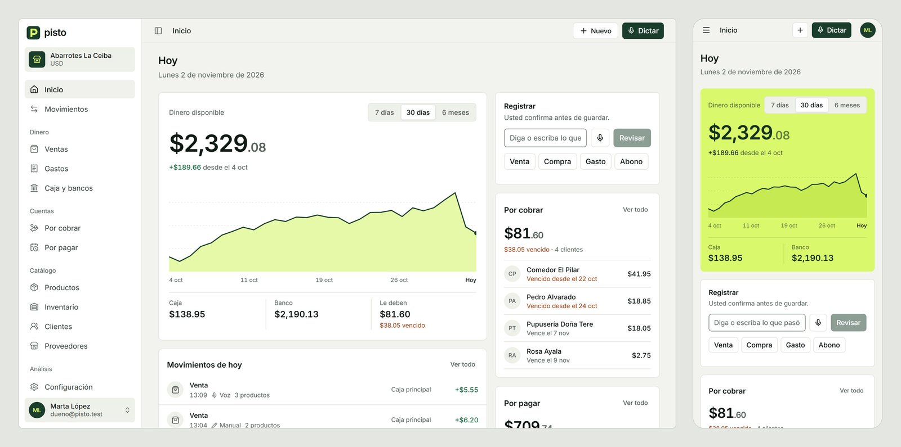
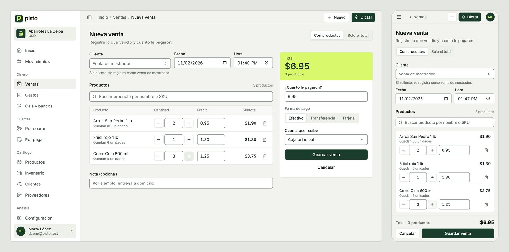
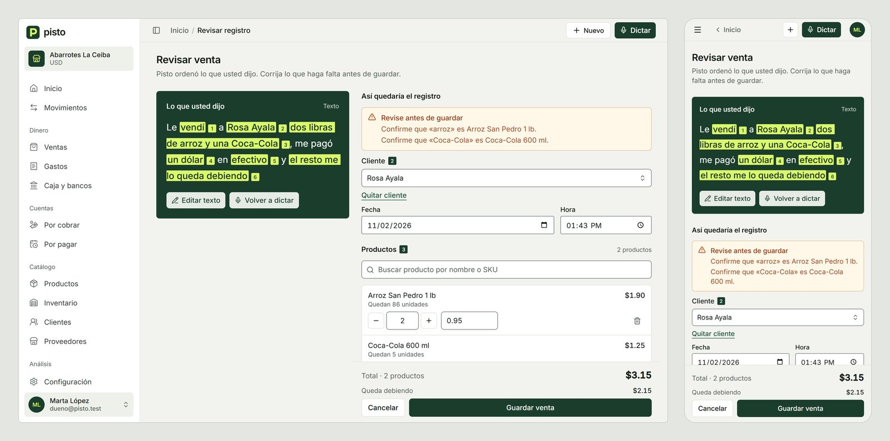
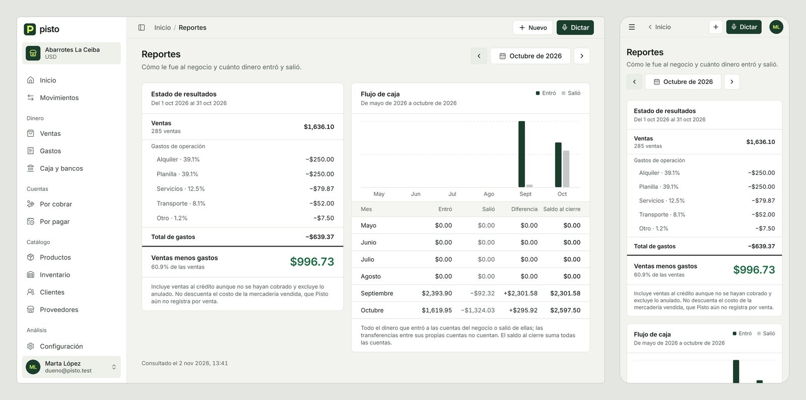
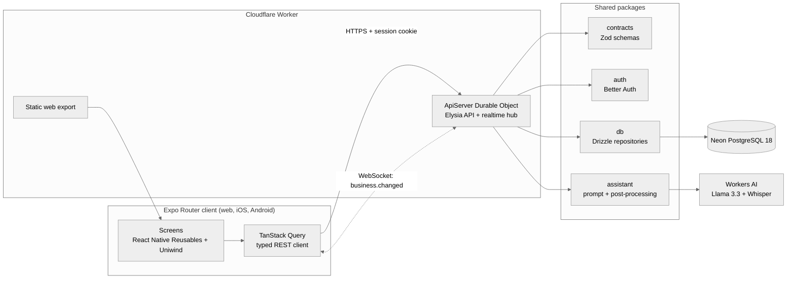

# Pisto

[](https://github.com/Eclalune-BTC/pisto-app/actions/workflows/ci.yml)
[](https://pisto.contact-862.workers.dev)
[](LICENSE)

Bookkeeping for small shops in Latin America. Pisto records sales, purchases, expenses, cash and
bank accounts, who owes the business and whom it owes, and keeps inventory and reports exact. An AI
assistant turns a dictated or typed sentence ("Le vendí a Rosa dos libras de arroz y me quedó
debiendo") into a draft record that the user reviews before saving.

The interface is Spanish (`es-SV`); code and documentation are English.

**[Try the live demo](https://pisto.contact-862.workers.dev)** with `dueno@pisto.test` /
`PistoDemo2026`.



| Recording a sale | Reviewing a dictated sentence | Reports |
| --- | --- | --- |
|  |  |  |

## Engineering highlights

- **Money is exact.** Amounts are integer minor units end to end. Financial commands carry an
  idempotency key, run in one database transaction, write an append-only operation receipt and are
  corrected by void or reversal entries, never by deleting history.
- **The server owns the tenant.** Every `/v1` request resolves the active business and the member's
  role on the server; a client can never choose whose data it reads or writes. Owner, admin and
  seller permissions are checked per operation.
- **AI proposes, the user decides.** The model (Workers AI) only returns a typed draft. Deterministic
  code matches products and customers, recomputes totals, flags mismatches and stock problems, and
  the confirmed record goes through the same validated command as a manual entry.
- **One contract, three runtimes.** Zod schemas in `packages/contracts` validate requests and
  responses for the Expo client, the Bun server and the Cloudflare Worker.
- **Realtime without polling.** A WebSocket hub notifies every open session of a business when its
  data changes, and each screen refetches only what it shows.
- **Deliberate hosting.** The API runs inside a Durable Object so one PostgreSQL pool and the
  realtime sockets survive across requests on Workers
  ([ADR 0020](docs/adrs/0020-cloudflare-workers-neon-hosting.md)). The same code runs on Bun and in
  a Docker image locally.
- **Decisions are recorded.** Nineteen [architecture decision records](docs/adrs/README.md) explain
  why each boundary exists.

## Architecture



| Path | Responsibility |
| --- | --- |
| `apps/app` | Expo Router universal client and platform adapters |
| `apps/api` | Elysia HTTP composition, middleware, realtime hub, Docker image and Worker entry |
| `packages/contracts` | Transport-neutral request, response and error schemas |
| `packages/db` | PostgreSQL schema, migrations and repositories |
| `packages/auth` | Better Auth server configuration |
| `packages/assistant` | Model prompts, extraction and deterministic review of drafts |
| `packages/billing` | Provider-neutral entitlements and adapters (disabled by default) |
| `packages/config` | Shared server environment parsing |
| `scripts` | Setup, diagnostics, seed and smoke-test CLI |

Read more in [architecture](docs/architecture.md), the [data model](docs/data-model.md), the
[API guide](docs/api-elysia.md) and [security](docs/security.md).

## Tech stack

- **Client:** Expo SDK 57, React Native 0.86, React 19, Expo Router, TanStack Query, React Native
  Reusables, Uniwind (Tailwind CSS 4), i18next
- **Server:** Bun 1.4, Elysia 1.4, Better Auth 1.7, Drizzle ORM, PostgreSQL 18, Zod 4
- **Hosting:** Cloudflare Workers and Durable Objects, Neon, Workers AI
- **Tooling:** Turborepo, Biome, Vitest and Bun test, GitHub Actions, Docker

## Features

| Area | What it does |
| --- | --- |
| Sales | Itemized or total-only sales, cash or credit, history, void and correction |
| Purchases | Suppliers, purchases on cash or credit, supplier payments and accounts payable |
| Cash and banks | Accounts, adjustments, transfers and a single ledger of every movement |
| Receivables | Customers, credit sales, payments and reversals, overdue balances |
| Catalog and inventory | Categories, products, stock receipts, adjustments and reversals |
| Reports | Income statement, monthly cash flow and the money trend on the home |
| Team | Owner, admin and seller roles; the owner adds, re-roles and removes staff |
| Assistant | Dictate or type a sale, purchase, expense or payment and review the draft |

Every flow works end to end from the screen through the API to PostgreSQL; the full list with
routes is in [features](docs/features.md).

## Demo accounts

`bun run db:seed` creates the business *Abarrotes La Ceiba* with six weeks of coherent history:
daily sales, weekly purchases, monthly expenses, credit sales and payments, customers who owe, an
overdue supplier invoice and products running low. The hosted demo has the same data. The password
for every account is `PistoDemo2026` unless `SEED_PASSWORD` was set.

| Role | Email | Can do |
| --- | --- | --- |
| Owner | `dueno@pisto.test` | Everything, including business settings and staff |
| Admin | `encargado@pisto.test` | Every operation except business settings |
| Seller | `vendedor@pisto.test` | Record sales (including on credit); view catalog, stock and customers |

## Run it locally

Requires Git, [Bun](https://bun.sh/) 1.4+, [Node.js](https://nodejs.org/) 24 and a running
[Docker Desktop](https://www.docker.com/products/docker-desktop/).

```sh
git clone https://github.com/Eclalune-BTC/pisto-app.git
cd pisto-app
bun install --frozen-lockfile
bun run setup                       # creates .env files with a random auth secret
docker compose up -d --wait postgres
bun run db:migrate
bun run db:seed
```

Then, in two terminals:

```sh
bun run dev:api                     # API on http://localhost:3001
bun run --cwd apps/app web          # web app on http://localhost:8081
```

Open <http://localhost:8081> and sign in with a demo account. The assistant needs Workers AI: run
the API as the Worker (`npx wrangler dev` in `apps/api`) or set `CLOUDFLARE_ACCOUNT_ID` and
`CLOUDFLARE_AI_API_TOKEN` in `.env`. Phones, emulators, environment variables and troubleshooting
are covered in [getting started](docs/getting-started.md).

## Testing

| Command | What it covers |
| --- | --- |
| `bun run check` | Lint and format, documentation links, type checks, every unit test and the web export |
| `bun run test:integration` | Repository suites against a real PostgreSQL 18 database |
| `bun run smoke:local` | Signs up, creates a business and a sale, checks the report, voids it and signs out |
| `bun run test:e2e` | Playwright in a real browser: owner home, a sale and its stock effect, seller permissions |
| [Postman collection](docs/postman/README.md) | 147 requests with assertions, including negative and permission checks |

CI runs `check`, the integration suites and the end-to-end tests, plus the dependency audit, schema
checks and the Docker image contract. See [testing and release](docs/testing-release.md).

## Deployment

The demo runs on Cloudflare Workers: one Worker serves the web export and forwards API traffic to a
Durable Object that talks to Neon through a least-privilege role. The procedure is in
[the deployment runbook](docs/deployment-cloudflare.md).

## Contributing

See [CONTRIBUTING.md](CONTRIBUTING.md) and the [documentation map](docs/README.md).

## License

[MIT](LICENSE)
