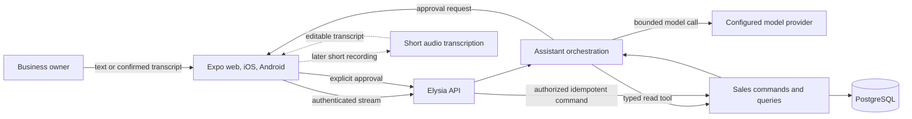

# AI assistant architecture

- Status: **accepted target architecture; the registration slice (one sentence to a reviewed
  draft) is implemented on Workers AI by [ADR 0021](adrs/0021-workers-ai-registration-assistant.md)**
- Research date: **2026-08-22**; provider and models **2026-11-02**
- Recheck trigger: AI SDK, Expo, Bun, model provider, voice, retrieval, privacy, or deployment change

## Implemented registration slice

[ADR 0021](adrs/0021-workers-ai-registration-assistant.md) owns the decision and its evaluation.
In short: `POST /v1/assistant/interpretations` sends one sentence to `assistant.extract`
(Llama 3.3 70B on Workers AI) through a small typed adapter in `packages/assistant`; the model only
extracts fields and quoted fragments, and deterministic code resolves names in the active business,
computes money, dates, accounts and notices, and returns a draft. `POST /v1/assistant/transcriptions`
turns a 16 kHz WAV into editable text with `assistant.transcribe` (Whisper large v3 turbo). The app
reviews the draft at `/operate/assistant/review` and saves only through each record's own command.
AI SDK is not installed for this slice; the target below still applies to the conversational
assistant.

For a supplier payment, the review can suggest a purchase only within the active business and
matched supplier. A stated invoice must identify one purchase with an outstanding balance.
Ambiguous references, including a number reused on a settled purchase, leave the choice open.
Without an invoice reference the earliest due open purchase is suggested. The reviewer can
change the purchase before confirming. When extraction identifies a partially paid purchase,
the app explains how to record the credit purchase and its payment separately. Evaluation set
`2026-11-18.1` adds both a missing supplier invoice and a mixed purchase payment to the original
16 Spanish cases. Set `2026-11-18.2` adds a guided sale, a product price and a declined action. Set
`2026-11-19.1` adds nine business questions, an unsupported period and a request for advice.

## Guided sale and catalog tools

Coco helps a signed-in member start a sale by typing, choosing an action or confirming a
transcript. A general request to enter a sale opens the sale guide. A product lookup presents
active catalog matches by name or SKU, with the price and stock returned by the catalog API.
The member chooses the product before the itemized form opens. That form owns quantity,
payment, validation, confirmation, idempotency, stock effects and the canonical sale receipt.
The ordinary new-sale route remains available, including its pending total-only review.

The assistant can propose two typed actions, `start_sale` and `find_product`. The latter's
optional search term must be grounded in the user's sentence. Actions have fixed destinations
and use the current membership's assistant, sales and catalog permissions. The catalog query
and sale command authorize the actor again. The client keeps working text in the current
session, clears it on a business change, and distinguishes loading, denied, unavailable and
successful empty results. Explicit actions also work when the model is off. The browser
supports opt-in recording and native clients use text. Acceptance covers keyboard and touch,
the chosen product in a draft, cancellation, and an explicitly confirmed sale in an isolated
business. The UI uses the existing Expo controls for tool selection, review and explicit confirmation,
following the interaction pattern in [Vercel AI Elements](https://elements.ai-sdk.dev/components/tool).

## Product follow-ups

Product-specific follow-ups use the selected catalog record and an ephemeral quote context. DeepSeek classifies the follow-up. Pisto grounds the quantity, rechecks the current business and computes the amount from the freshly read catalog. Asking for a sale opens a reviewed, editable itemized sale. See [ADR 0022](adrs/0022-contextual-catalog-questions.md).

## Business questions

A member asks about the business by text or confirmed dictation and reads the answer in Coco's
dialog. [ADR 0023](adrs/0023-business-questions-from-exact-reads.md) owns the decision.

- **Topics:** sales, best-selling products, expenses, a period summary, money available,
  receivables, payables and low stock. **Periods:** today, yesterday, this or last week (Monday
  first), this or last month and the last 7 or 30 days, in the business time zone. Without a stated
  period the answer covers the month in progress and says so.
- **Classification:** the extraction prompt returns the kind `ask` with a topic and a period from
  those closed sets; the server answers with the tool call `answer_question`. Complete known
  phrasings are matched in the app without a model call and work with the assistant off.
- **Read:** `GET /v1/assistant/answers` authorizes `assistant:use` plus the topic's permission
  (`businessTopicPermissions`) and composes the answer from the repositories behind the screens.
  Sales and the product ranking use `SalesRepository.getPeriodSummary` under `sales:summary:read`.
  The route calls no model and spends the product read budget.
- **Wording:** the app words the exact values. An empty period is a sentence, a failed read an
  error with a retry, a missing permission a plain refusal. The summary never calls sales minus
  expenses a profit, and a ranking says how many sales carried no product lines.
- **Thread:** up to four exchanges kept in memory, a period control on the latest answer, a link to
  the screen that owns the figures and three suggested questions. Nothing is persisted or written.
- **Declined:** another period (a named month, a year, a date range), one customer or supplier,
  advice and forecasts. Coco lists what it can answer.

## Decision summary

The accepted target is AI SDK 7, with current APIs to be revalidated before implementation, as a
thin server-side orchestration layer for
streaming, typed tools, structured output, approvals, transcription, and provider adapters. The exact
patch and first provider package are selected and pinned only after the implementation spike validates
the current APIs against Bun, Elysia, the portable API container, Expo web, iOS, and Android.

PostgreSQL remains the only authoritative business datastore. The assistant calls narrow Pisto-owned
commands and queries. It never owns accounting rules, executes arbitrary SQL, trusts generated totals,
or writes directly from unvalidated model output.

Start with text and short request-bound interactions. Add push-to-talk transcription after the text
sale flow is useful and safe. Do not add Redis stream resumption, durable workflow agents, RAG,
pgvector, Neo4j, GraphRAG, or realtime voice without the evidence gates in this guide.

## Planned flow

The model can propose or select a tool. Only deterministic code can authorize, calculate, and commit
the operation.

## Planned ownership

The registration package exists. Conversational orchestration is future work. Existing product
commands stay with their capability owners.

| Owner | Responsibility | Prohibited ownership |
| --- | --- | --- |
| `apps/app` | Conversation UI, approval surface, stream state, short-recording adapter | Provider keys, prompts, business authorization |
| `apps/api` | HTTP/stream composition, auth resolution, rate and size limits | Generated business rules or provider-specific domain types |
| `packages/contracts` | Pisto-owned public turn, draft, approval, result, and error schemas | Raw provider responses or database rows |
| `packages/db` capability modules | Product invariants, exact queries, commands, audit, schema, and transactions | AI SDK, prompts, tool selection, or UI state |
| `packages/assistant` (future conversational work) | AI SDK configuration, prompt versions, tool registry, bounded orchestration | SQL, canonical financial calculations, or authorization policy |

The API is the composition root. The assistant package receives authorized product capabilities; the
product domain does not depend on the assistant. A separate sales package requires the ownership
evidence in [Repository layout](repository-layout.md); exposing existing commands as tools does not
require that extraction.

## Provider and model boundary

- Use AI SDK 7 Core on the server. Do not put model or transcription credentials in Expo.
- Start with one direct provider adapter that passes Pisto's Spanish financial-intent evaluation.
  Installing every provider package in advance adds cost without portability.
- Keep one validated server-side registry of stable task aliases such as `assistant.primary` and
  `transcription.primary`. Product code does not scatter provider or model IDs.
- Vercel AI Gateway is an optional provider adapter, not a requirement of using AI SDK. Selecting it
  requires a documented data path, credentials, cost controls, regional/privacy review, and an ADR
  amendment.
- A provider/model change is a release change. Run the same extraction, tool-selection, refusal,
  latency, and cost evaluations before promotion.
- Provider-specific options stay at the external adapter edge. A feature cannot depend silently on a
  provider-only tool or message shape.
- Do not silently fail over. An approved fallback must have equivalent required capabilities, an
  observable activation reason, bounded retry behavior, privacy review, evaluation evidence, and no
  chance of replaying a financial mutation.
- If the provider is unavailable, show a degraded assistant state and preserve structured product
  screens. Do not return a canned answer or pretend the write succeeded.

## Tool model

Use a small static tool set with Zod schemas and server-owned execution.

### Read tools

Read tools may execute automatically after authentication and authorization. Examples include a
bounded sales summary or sale lookup. They return domain-shaped facts, period/scope metadata, and data
freshness. They never expose SQL, unrestricted filters, another tenant, or raw persistence rows.

### Mutation tools

Financial mutations use AI SDK 7 call-level approval policy or an equivalently strong Pisto-owned
draft/confirmation protocol. The implementation must bind the approval to the original typed inputs,
authenticated subject, business, expiry, and idempotency key. HMAC-hardened approval is preferred when
the selected AI SDK flow supports it.

Approval is not authorization. On continuation, the server reloads current membership and state,
revalidates the complete command, recomputes money, applies domain rules, and commits transactionally.

Do not expose arbitrary SQL, shell, filesystem, generic HTTP, billing-provider, entitlement-mutation,
role-management, or tool-discovery capabilities to the product model.

## Conversation and canonical data

- Persist server-generated conversation and message IDs only when the product needs history.
- Scope every conversation to the authenticated user and business.
- Validate loaded UI messages before converting them to model messages.
- Store prompt version, model alias, completion state, token/cost metadata, and bounded tool audit data.
- Minimize or redact tool arguments/results that repeat sensitive business data.
- Do not enable telemetry recording of prompts or outputs by default.
- Define retention/export/deletion before production. Deleting a conversation does not delete its
  confirmed canonical sale; voiding a sale does not require retaining raw model text.
- Do not create automatic long-term "memory" from conversation. Business preferences become explicit
  validated settings with their own owner and audit path.

## Streaming and Expo compatibility gate

Elysia documents AI SDK integration through Web Standard response streams, and AI SDK documents an
Expo client path. These references were reviewed for HTTP composition on 2026-10-03; current upstream
examples can target newer APIs than the pinned Elysia 1.4.30 baseline. They do not establish Pisto
compatibility or implemented assistant behavior. Before adopting the package:

1. pin the exact AI SDK 7 and provider versions;
2. run `streamText` through Pisto's Bun/Elysia server and container;
3. validate credentials/cookies, headers, cancellation, disconnect, proxy buffering, timeouts, and
   structured errors;
4. exercise `@ai-sdk/react` with Expo 57 web, iOS, and Android using the documented stream headers and
   any still-required polyfills;
5. use Expo's standards-based `expo/fetch` streaming implementation where a custom transport is
   required; and
6. keep a narrow Pisto client transport boundary if AI SDK UI is not compatible on one target.

Do not add React Server Components or a Next.js-only route to the universal product. The assistant's
product contracts remain Pisto-owned even if the wire stream uses AI SDK UI parts.

Initially, persist completed turns and report an interrupted state after disconnect. Do not add Redis
and resumable-stream infrastructure until measured reconnect behavior justifies its security,
operational, abort, and race complexity.

## Execution bounds

The first assistant flow uses `streamText` or an explicit structured workflow, not an autonomous
general-purpose agent:

- no more than three or four model steps per turn;
- only the tools relevant to the current intent;
- explicit total, per-step, per-chunk, and per-tool timeouts;
- bounded provider retries only for safe reads or pre-effect idempotent operations;
- output-token, audio-size/duration, per-user, per-business, and environment cost limits;
- abort propagation from client through provider/tool execution; and
- a server kill switch that disables AI without disabling canonical product access.

Do not adopt `WorkflowAgent` or another durable agent runtime until a real operation must survive a
deployment, outlive one request, or wait for a long approval.

## Voice boundary

No voice provider or dependency is selected. The first possible voice capability uses `expo-audio`
and AI SDK 7's stable server-side transcription API only after text behavior is proven, a separate
brief is approved, and the exact provider/account is verified.

- Use a visible press-to-record control and request permission in context.
- Keep background recording disabled.
- Cap duration and bytes and allow only tested formats from web, iOS, and Android.
- Use the narrow authenticated audio transport specified in the voice guide; do not weaken the
  JSON API client or use base64 JSON. Resolve transport details in the approved voice brief.
- Treat audio and transcripts as sensitive business data.
- Delete Pisto's raw-audio copy after transcription and a short documented retry window by default;
  separately verify provider retention/deletion instead of implying local deletion controls it.
- Return editable text to the composer; do not submit or execute it automatically.
- Provide silence, permission-denied, unsupported-format, timeout, provider-error, cancellation, and
  offline states.
- Keep batch transcription, optional streaming STT, optional TTS, and full realtime conversation as
  separately approved capabilities and aliases.

ElevenLabs is an evaluated candidate, not an architecture choice. If a voice brief is approved,
evaluate first whether AI SDK 7 plus the direct ElevenLabs provider fits `transcription.primary`; a
small raw REST adapter is allowed only if an evaluated requirement is missing. This is evaluation
order, not provider selection. AI Gateway, ElevenAgents/Speech Engine, TTS, and realtime voice are
not selected for the push-to-talk slice.

Realtime speech-to-speech remains experimental in AI SDK 7 and is not the first voice architecture.
Add it only after a measured hands-free or latency requirement justifies ephemeral-token, WebSocket,
interruption, privacy, provider-capability, and native-device work.

See [Voice architecture and ElevenLabs evaluation](voice-architecture.md) for transport, credentials,
retention, state, accessibility, cost, evaluation, and provider-selection gates.

## Retrieval decision ladder

1. Use exact relational queries for sales, inventory, expenses, customers, balances, and reports.
2. Use PostgreSQL full-text search for names, descriptions, and notes when keyword search is needed.
3. Add pgvector for an approved unstructured corpus only when a labeled evaluation proves a material
   semantic-retrieval improvement. Keep tenant filters and source provenance in PostgreSQL, record the
   embedding provider/model/version, and define re-embedding and deletion propagation.
4. Add Neo4j only for proven variable-depth multi-hop graph questions that benchmark poorly in
   PostgreSQL and justify a second datastore, authorization projection, synchronization, backup,
   reconciliation, and operations model.
5. Add GraphRAG only when evaluated cross-document relationship questions justify both the graph and
   a separate Python ingestion runtime.

Approximate vector indexes trade recall for speed. Begin with exact search at small scale and add HNSW
only after corpus size and measured latency require it. Verify the actual pgvector version in the
approved PostgreSQL environment before relying on a feature; no hosted provider is currently selected.

## Testing and evaluation contract

- Unit-test orchestration with AI SDK mock language and embedding models; no provider call is needed.
- Test every tool schema, approval/denial, authorization, idempotency, timeout, cancellation, and
  duplicate continuation path.
- Run database integration tests for tenant isolation, money precision, transaction atomicity, audit,
  correction, and period boundaries in the business time zone.
- Maintain versioned Spanish evaluation cases for complete, incomplete, ambiguous, adversarial, and
  prompt-injected sale/report requests.
- A structured schema pass is not a semantic pass. Score exact extracted fields, clarification,
  correct tool choice, abstention, unsupported requests, and revenue-versus-profit language.
- Compare every provider/model candidate on the same dataset and record quality, latency, token usage,
  cost, and failure rate.
- Exercise streaming and recording on compact native, compact web, and wide web plus physical devices
  before release claims.

## Privacy and observability

Record safe operational metadata: request/turn ID, opaque user/business reference, model alias,
prompt version, tool name, approval outcome, latency, token counts, estimated cost, finish reason, and
bounded error code. Do not record raw prompts, transcripts, audio, model output, full tool arguments,
or canonical records in telemetry by default.

The provider data-use, retention, training, region, subprocessors, and deletion terms are a release
decision and must be reviewed against the exact selected account/product. Deleting Pisto's local
copy does not prove provider deletion, and Internet documentation does not prove the configured
account setting.

## Current capability state

| Capability | State |
| --- | --- |
| Product brief and target architecture | Approved and documented |
| AI SDK | Not installed; the registration slice uses a typed Workers AI adapter (ADR 0021) |
| Provider | Workers AI: `AI` binding in the Worker, REST credentials for the local Bun API, `ASSISTANT_ENABLED` kill switch |
| Registration routes, package, prompt, UI | Implemented: `/v1/assistant/status`, `/interpretations`, `/transcriptions` and `/answers`; `packages/assistant`; prompt `extract-2026-11-19.1`; Coco, its tool menu, dictation, home composer, question thread and review route |
| Follow-up conversation and streaming | Scoped product conversation with price, stock, quantity quotes and reviewed sale preparation, and a question thread of up to four exact answers. Each turn is classified on its own; no streaming. |
| Sales, catalog, inventory, expense, cash, customer, and receivable product data | Implemented; source synchronized. Validation and remaining platform/release limits are in [release evidence](release-evidence.md) |
| Business reads behind the answers | The operating report, money trend, receivables summary and debtors, payables summary, stock list and the ranged sales summary; `answer_question` selects one by topic |
| Sale and catalog tools | `start_sale` opens the sale form, `find_product` queries the authorized catalog. Only the existing product forms confirm mutations. |
| Voice recording or transcription | Web push-to-talk to 16 kHz WAV and batch Whisper transcription; native builds are text-only |
| Conversation persistence or long-term memory | Not implemented |
| RAG, embeddings, pgvector, Neo4j, or GraphRAG | Intentionally not selected |
| Provider sandbox/device/deployment evidence | 31/31 on Spanish set `2026-11-19.1` (20 registration and tool cases, 11 question cases) with prompt `extract-2026-11-19.1` through the remote Workers AI binding, median 4.4 s per sentence; web recording was exercised in Chrome with a synthetic Spanish voice. Physical-device and real-speaker evidence remain open. |

## Primary sources

- [Vercel AI SDK 7 release](https://vercel.com/changelog/ai-sdk-7)
- [AI SDK provider and model management](https://ai-sdk.dev/docs/ai-sdk-core/provider-management)
- [AI SDK tools and approvals](https://ai-sdk.dev/docs/ai-sdk-core/tools-and-tool-calling)
- [AI SDK loop control](https://ai-sdk.dev/docs/agents/loop-control)
- [AI SDK testing](https://ai-sdk.dev/docs/ai-sdk-core/testing)
- [AI SDK message persistence](https://ai-sdk.dev/docs/ai-sdk-ui/chatbot-message-persistence)
- [AI SDK Expo quickstart](https://ai-sdk.dev/docs/getting-started/expo)
- [AI SDK transcription](https://ai-sdk.dev/docs/ai-sdk-core/transcription)
- [AI SDK speech](https://ai-sdk.dev/docs/ai-sdk-core/speech)
- [AI SDK ElevenLabs provider](https://ai-sdk.dev/providers/ai-sdk-providers/elevenlabs)
- [Elysia AI SDK integration](https://elysiajs.com/integrations/ai-sdk)
- [Expo SDK 57 streaming fetch](https://docs.expo.dev/versions/v57.0.0/sdk/expo/)
- [Expo Audio](https://docs.expo.dev/versions/v57.0.0/sdk/audio/)
- [ElevenLabs single-use tokens](https://elevenlabs.io/docs/api-reference/tokens/create)
- [ElevenLabs Zero Retention Mode](https://elevenlabs.io/docs/eleven-api/resources/zero-retention-mode)
- [PostgreSQL full-text search](https://www.postgresql.org/docs/18/textsearch.html)
- [pgvector](https://github.com/pgvector/pgvector)
- [Neo4j graph database concepts](https://neo4j.com/docs/getting-started/graph-database/)
- [Neo4j GraphRAG requirements](https://neo4j.com/docs/neo4j-graphrag-python/current/)
